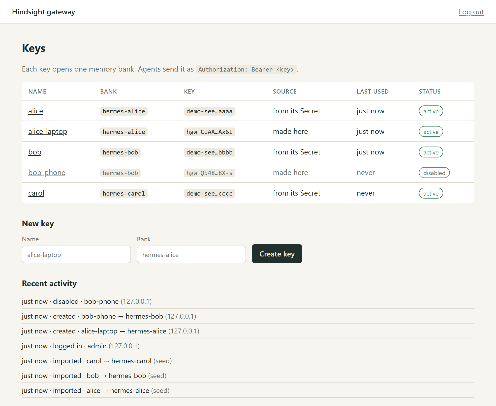

# hindsight-gateway

Per-bank API keys for [Hindsight](https://github.com/vectorize-io/hindsight), with a small web UI to manage them.

Hindsight's API has no authentication of its own: anything that can reach it can read or change any memory bank. This gateway sits in front of it. Each API key opens exactly one bank, and everything else is refused: other banks, deleting a whole bank, aliases, clones, transfers between banks, webhooks and bank config changes. The global reads a dashboard needs are scoped to the key's bank: the bank list shows only that bank, a chunk lookup answers only for its chunks, and an export download only for its archives. Endpoints Hindsight adds later stay blocked until the gateway allows them.

Because of that, Hindsight's own control-plane UI can run against the gateway with one person's key and show only that person's bank (Hermify does this with a patched UI that signs each person in with their own key).

I wrote it for [Hermify](https://github.com/omar2535/Hermify), where several people's agents share one Hindsight, but it works in front of any Hindsight.

<picture>
  <source media="(prefers-color-scheme: dark)" srcset="docs/screenshot-dark.png">
  
</picture>

## How it works

- **Port 8889: the API.** Agents use it exactly like Hindsight's API, with `Authorization: Bearer <key>`. The gateway checks the key and the path, then forwards the request.
- **Port 8890: the admin UI.** Create, rename, move, disable, rotate and delete keys, and see when each was last used. Logins use one admin password. Keep this port away from your agents.
- **Keys** are stored in a SQLite file as SHA-256 hashes. A key's full value is shown once, when it's created or rotated.
- **Seed keys** let you import keys you already have (for example one per agent, from Kubernetes Secrets). They're imported on start. After that the UI owns them: a key you rotate, rename or delete in the UI stays that way, even though its Secret still has the old value.

Standard library Python, no dependencies.

## Run it

```sh
docker run -d -p 8889:8889 -p 8890:8890 -v hgw-data:/data \
  -e HGW_UPSTREAM=http://hindsight:8888 \
  -e HGW_ADMIN_PASSWORD='something long' \
  ghcr.io/omar2535/hindsight-gateway:0.2.0
```

Then open `http://<host>:8890`, log in, and create a key for each agent. Point the agent at `http://<host>:8889` with that key (for Hermes Agent, see below).

To put both on one hostname behind a reverse proxy, set `HGW_API_PREFIX=/api` and `HGW_ADMIN_PREFIX=/ui`, then route `/api` to port 8889 and `/ui` to port 8890 (no path rewriting needed). Agents then use `https://<host>/api`, and the UI is at `https://<host>/ui/`.

Make sure nothing but the gateway can reach Hindsight's own port. In Kubernetes, use a NetworkPolicy that only lets the gateway's pod in (Hermify sets this up for you).

## Use it with Hermes Agent

Create a key in the UI first. Then, on the machine running Hermes:

```sh
hermes plugins install hindsight --enable
hermes config set memory.provider hindsight
cat >> ~/.hermes/.env <<'EOF'
HINDSIGHT_MODE=local_external
HINDSIGHT_API_URL=http://<host>:8889
HINDSIGHT_API_KEY=<the key>
HINDSIGHT_BANK_ID=<the key's bank>
EOF
chmod 600 ~/.hermes/.env
hermes memory status
```

Use `https://<host>/api` as the URL if the API is behind a prefix. Restart Hermes's gateway afterwards if it's already running (`hermes gateway restart`).

- **Set `HINDSIGHT_BANK_ID` to the key's bank.** The plugin's default bank is `hermes`, and `hermes memory setup` doesn't ask for one, so without it every request is refused.
- **`~/.hermes/hindsight/config.json` wins over `.env`.** If an earlier `hermes memory setup` left that file, its mode, URL and key are used instead (the bank in `.env` still applies). Delete the file, or set `api_url` and `bank_id` in it.
- **Put the key in `.env` yourself.** Don't paste it into a chat and ask the agent to set itself up: the key then goes to the LLM provider and into the agent's saved sessions and memory.

## Configuration

| Variable | Default | |
|---|---|---|
| `HGW_UPSTREAM` | (required) | Hindsight's API, e.g. `http://hindsight:8888` |
| `HGW_ADMIN_PASSWORD` | empty | Admin UI password. Without it, logins are refused. |
| `HGW_LISTEN` | `0.0.0.0:8889` | The API |
| `HGW_ADMIN_LISTEN` | `0.0.0.0:8890` | The admin UI; empty turns it off |
| `HGW_DB` | `/data/gateway.db` | The SQLite file |
| `HGW_API_PREFIX` | empty | e.g. `/api`: serve the API under this path too, so one hostname can carry both. Bare paths keep working. |
| `HGW_ADMIN_PREFIX` | empty | e.g. `/ui`: where the admin UI lives on that hostname |
| `HGW_COOKIE_SECURE` | `true` | Set `false` only to use the UI over plain HTTP, e.g. through `kubectl port-forward` |
| `HGW_MAX_BODY` | 64 MiB | Largest request body |
| `HGW_UPSTREAM_TIMEOUT` | `600` | Seconds |
| `HGW_SEED_<n>_NAME`, `HGW_SEED_<n>_BANK`, `HGW_SEED_<n>_KEY` | | Keys to import on start |

### Seed keys in detail

- A seed with a new name is imported.
- A seed whose value changed (you changed its Secret) updates that key, as long as the UI hasn't taken it over.
- A seed you rotated, renamed or deleted in the UI is never imported again.
- The bank and enabled/disabled state you set in the UI always win.

## A Hindsight UI for each person

`ghcr.io/omar2535/hindsight-ui:<hindsight version>` is Hindsight's own control-plane UI (every tab: Home with its graph, Memories, Recall, Reflect, Documents, Entities, Mental models...) with a small patch, [`control-plane/api-key-mode.patch`](control-plane/api-key-mode.patch). With `HINDSIGHT_CP_AUTH_MODE=api-key`, each person signs in with their own gateway key, and every call the UI makes for them carries that key. Point it at the gateway, and each person sees only their own bank.

```sh
docker run -d -p 9999:9999 \
  -e HINDSIGHT_CP_AUTH_MODE=api-key \
  -e HINDSIGHT_CP_DATAPLANE_API_URL=http://<gateway>:8889 \
  -e HINDSIGHT_CP_ACCESS_KEY="$(openssl rand -hex 32)" \
  ghcr.io/omar2535/hindsight-ui:1.2.1
```

- **Never point it at Hindsight itself.** Hindsight's API accepts any key, so everyone would see every bank. The gateway is what limits each key to one bank.
- `HINDSIGHT_CP_ACCESS_KEY` isn't a login here: it seals the session cookie (AES-GCM), which holds the person's key. Changing it signs everyone out. Sessions last 30 days; disabling a key in the gateway makes its session useless at once (every call gets 401).
- Without a session, the UI sends no key at all (`HINDSIGHT_CP_DATAPLANE_API_KEY` is ignored), so the gateway refuses the call.
- Give each person a key of their own for the UI, separate from their agent's, so either can be revoked alone. The UI can't delete the bank or change its config: the gateway refuses both.
- The patch adds three files and changes 14 lines in three others; all of the UI's dataplane calls get the key from one `fetch` wrapper installed at startup, so new upstream pages need no change. The image is tagged with the Hindsight version it's built from. A workflow builds each new Hindsight release daily, runs the smoke test (`control-plane/smoke.py`: one key, one bank) and pushes; if the patch stops applying, nothing is pushed.

## Security

- Keys are only ever stored as hashes, and never logged. The log records method, path (without the query string) and status, and names the key behind each refused request.
- The admin UI uses signed, HttpOnly, SameSite=Strict session cookies, CSRF tokens on every form, a strict Content-Security-Policy and no JavaScript. Failed logins are throttled.
- Put the admin UI behind TLS, and keep both ports off the public internet unless you've thought hard about it: the keys are the only thing between your network and the banks.

See [SECURITY.md](SECURITY.md) to report a problem.

## Development

```sh
PYTHONPATH=. python3 -m unittest discover -s tests -t tests
```

The tests run a fake Hindsight that records every request, so they check that refused requests never reach it. To release, bump `__version__` in `hindsight_gateway/__init__.py`, add a [CHANGELOG](CHANGELOG.md) section, and push a `v<version>` tag. The Release workflow builds the image for amd64 and arm64 and pushes it to `ghcr.io/omar2535/hindsight-gateway`.

The per-person UI image (above) is built by the Control-plane UI workflow, not by releases: `control-plane/build.sh <hindsight version> <tag> --load`, then `PYTHONPATH=.:tests python3 control-plane/smoke.py <tag>`.

## License

[MIT](LICENSE). Not affiliated with Vectorize or the Hindsight project.
